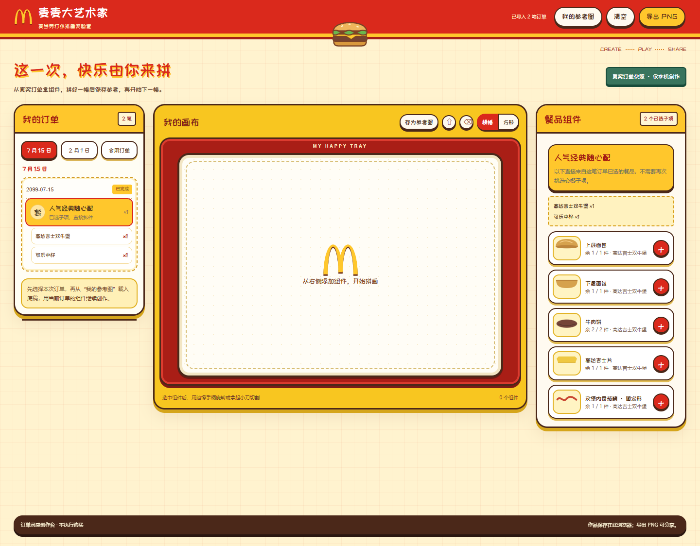

# 麦麦大艺术家

把每个人自己的麦当劳订单，变成一盒可以拖拽、旋转、切割和重新组合的食物拼画素材。

> 麦当劳程序员创意开发大赛参赛作品。独立开发，非麦当劳官方产品。



## 作品亮点

- **本人订单驱动**：通过麦当劳 MCP 的 `order-list` 与 `query-order` 读取当前用户明确选择的历史订单。
- **真实订单结构**：套餐使用用户已经选择的子项，数量和定制随订单进入创作器。
- **限量组件创作**：面包、肉饼、薯条、杯子、冰块等组件按订单配额使用，不能无限复制。
- **自由拼画工具**：支持拖拽、缩放、任意角度旋转、刀形切割、撤销、清空与 PNG 画框导出。
- **参考图续作**：载入旧作品作为底稿，继续使用当前订单组件，另存新图且不覆盖旧作品。
- **隐私最小化**：不把 Token、订单号、手机号、地址、支付或取餐信息写入生成页面。

## 目标用户

- 想把自己的点餐记录做成个性化视觉作品的麦当劳用户。
- 想体验 MCP 数据如何转化为互动创意工具的开发者。
- 想基于单文件 HTML 继续扩展食物拼画、订单纪念卡或社交分享玩法的创作者。

## 工作流程

```text
每位用户申请自己的麦当劳 MCP Token
                ↓
在 WorkBuddy 配置本人麦当劳连接器
                ↓
安装并调用「麦麦大艺术家」Skill
                ↓
选择本人订单 → 清洗最小字段 → 生成个人创作台
                ↓
拼画 / 切割 / 保存参考图 / 导出 PNG
```

## 安装

### 1. 申请个人麦当劳 MCP Token

打开 <https://open.mcd.cn/mcp>，使用本人手机号验证登录，在控制台激活并复制 Token。每位用户必须使用自己的 Token，不要共享或提交 Token。

### 2. 在 WorkBuddy 配置麦当劳 MCP

将 [`mcp-config.example.json`](mcp-config.example.json) 的配置合并到 WorkBuddy 的 `~/.workbuddy/mcp.json`，把 `${MCD_MCP_TOKEN}` 替换为本人的 Token。保存后在连接器管理中信任并启用该服务。

官方接入地址为 `https://mcp.mcd.cn`，传输方式为 Streamable HTTP。完整说明见 [麦当劳 MCP 官方指南](https://github.com/M-China/mcd-mcp-server)。

### 3. 安装 Skill

将 [`skill/maimai-big-artist`](skill/maimai-big-artist) 整个目录复制到：

```text
~/.workbuddy/skills/maimai-big-artist/
```

重新打开会话后即可使用。也可以把该目录打包为 ZIP 后通过 WorkBuddy 导入。

## 使用示例

在 WorkBuddy 中输入：

```text
用麦麦大艺术家读取我最近一笔麦当劳订单，生成个人创作台。
```

也可以指定日期或多笔订单：

```text
用我 7 月 15 日的麦当劳订单开始创作。
把我 7 月 15 日和 2 月 1 日的订单合起来拼画。
更新我的订单，让我在旧参考图上继续创作。
```

Skill 会先让用户确认订单，再生成独立 HTML。生成页不会持续联网；再次同步订单需要回到 WorkBuddy 会话运行 Skill。

## 本地虚构演示

仓库包含两笔去身份化演示订单：2099-07-15 的人气经典随心配（高达吉士双牛堡 + 可乐中杯），以及 2099-02-01 的比翼双拼翅 + 鲜萃咖啡（金翼双飞蜜汁风味薄皮 V 翅 + 麦辣鸡翅 2 块 + 小杯鲜萃咖啡）。订单 ID 为公开演示专用，不包含真实账户资料。

```bash
node skill/maimai-big-artist/scripts/build.cjs examples/fictional-orders.json demo.html
```

用浏览器打开 `demo.html` 即可体验。构建器拒绝覆盖已有输出文件，以保护旧作品。

### 演示参考图续作

1. 选择 7 月 15 日套餐，添加组件并点击「存为参考图」，输入名称保存。
2. 切换到 2 月 1 日，打开「我的参考图」，点击「载入继续创作」。
3. 旧图作为可编辑底稿保留，当前订单仍为 2 月 1 日；添加蜜汁薄皮 V 翅或麦辣鸡翅组件。
4. 再次「存为参考图」并另起名字，图库同时保留原图和续作，不覆盖旧图。

参考图保存在当前浏览器；演示页不预置个人作品，首次打开需先保存一幅。

## 目录结构

```text
.
├── README.md
├── CONTEST_DECLARATION.md
├── MCP_INTEGRATION.md
├── mcp-config.example.json
├── workbuddy.md
├── THIRD_PARTY_NOTICES.md
├── SECURITY.md
├── examples/
│   └── fictional-orders.json
├── skill/
│   └── maimai-big-artist/
│       ├── SKILL.md
│       ├── assets/studio-template.html
│       ├── references/order-contract.md
│       └── scripts/build.cjs
└── tests/
    └── smoke-test.cjs
```

## MCP 接入

项目真实使用麦当劳中国提供的远程 MCP Server。详见 [`MCP_INTEGRATION.md`](MCP_INTEGRATION.md)。本项目只调用历史订单查询，不调用下单、支付、取消、地址修改或领券工具。

## 数据与隐私

- 公开仓库、示例、截图和测试只使用虚构订单。
- Skill 只保留日期、餐品名称、数量、定制和已核实组件。
- 生成页不包含 Token，也不会读取 WorkBuddy 的凭证文件。
- 参考图保存在当前浏览器 `localStorage`，不提供认证、加密或跨设备同步。
- 在共享设备上，应为不同用户使用不同 `workspaceKey`。

## 已知边界

- 新餐品必须先补充并核实拆件和插画，未知餐品不会自动套用通用形状。
- 公开网页不能继承访客的 WorkBuddy 授权；个人订单生成必须在用户自己的 WorkBuddy 会话中完成。
- 中薯 30 根、少冰 3 块、正常冰 6 块等为互动创作配额，不代表门店出品定量。
- 作品本地保存受浏览器、来源域名和清理数据影响，建议同时导出 PNG。

## 测试

测试使用虚构订单，覆盖：

- 多订单切换与套餐数量计算
- 组件库存限制
- 参考图续作保留当前订单
- 390px 与 1440px 无横向溢出
- 页面无脚本错误
- 模板不含作者真实订单标记

构建器本身零依赖；浏览器测试需要 Node.js 22.12+、本机 Chrome 和 `puppeteer-core`。在仓库目录安装开发依赖后运行：

```bash
npm install
npm test
```

Chrome 默认路径为 Windows 的 `C:/Program Files/Google/Chrome/Application/chrome.exe`；其他系统用 `CHROME_PATH` 环境变量指定实际浏览器路径。脚本见 [`tests/smoke-test.cjs`](tests/smoke-test.cjs)。

仓库自带的 [demo.html](demo.html) 可直接下载并用浏览器打开；[安装包](maimai-big-artist.zip) 可用于 Skill 导入。演示只含虚构订单，与本人授权查询流程独立。

## 参赛与许可

- 参赛声明：[`CONTEST_DECLARATION.md`](CONTEST_DECLARATION.md)
- WorkBuddy 开发记录：[`workbuddy.md`](workbuddy.md)
- 原创代码：MIT License
- 第三方商标、字体与服务：[`THIRD_PARTY_NOTICES.md`](THIRD_PARTY_NOTICES.md)

麦当劳及 Golden Arches 等标志属于其权利人。本仓库及项目不构成商标授权或官方背书。
